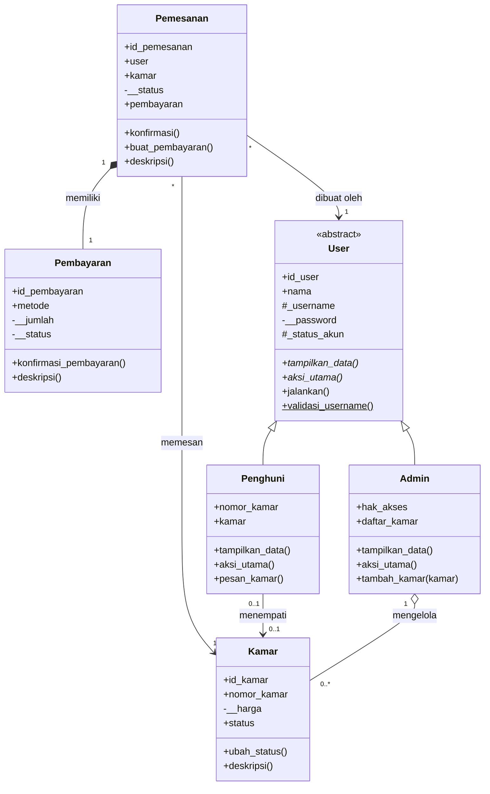

# Sistem Manajemen dan Pemesanan Kamar Kost

## Deskripsi Program

Program ini menggambarkan proses pengelolaan kamar kost dan pemesanan kamar oleh penghuni. Terdapat dua jenis pengguna, yaitu **Penghuni** (yang memesan kamar) dan **Admin** (pemilik/pengelola kost). Keduanya merupakan turunan dari class abstrak **User**.

Program dibuat dengan **Python** dan menerapkan konsep OOP: inheritance, abstraksi (ABC), polimorfisme, encapsulation, relasi antar class (asosiasi, agregasi, komposisi), serta instance/class/static method.

## Struktur Class

Program terdiri dari 6 class:

```text
Sistem Manajemen dan Pemesanan Kamar Kost
│
├── User (abstract)
│   ├── Penghuni
│   └── Admin
├── Kamar
├── Pemesanan
└── Pembayaran
```

---

# 1. Relasi UML (Class Diagram)


<details>
<summary>Kode Mermaid class diagram (untuk draw.io / mermaid.live)</summary>



</details>

Diagram menampilkan nama class, atribut/method utama, dan garis relasi. Selain tiga relasi wajib, diagram juga menampilkan pewarisan (segitiga kosong) dari `User` ke `Penghuni` dan `Admin`.

## Asosiasi (garis dengan panah terbuka)

**`Pemesanan` → `Kamar`**, **`Pemesanan` → `User`**, dan **`Penghuni` → `Kamar`**.
Objek-objek ini hanya saling mengenal (menyimpan referensi) tanpa saling memiliki. `Pemesanan` menyimpan `self.user` dan `self.kamar` yang diterima dari luar lewat constructor, sedangkan `Penghuni` menyimpan `self.kamar` sebagai kamar yang ditempati. Masing-masing objek tetap hidup sendiri-sendiri.

```python
class Pemesanan:
    def __init__(self, id_pemesanan, user, kamar, tanggal):
        self.user = user
        self.kamar = kamar
```

## Agregasi (belah ketupat kosong)

**`Admin` ◇── `Kamar`**.
Admin menyimpan daftar kamar yang dikelola (`daftar_kamar`) melalui `tambah_kamar()`. Dipilih **agregasi** karena objek `Kamar` dibuat secara terpisah di luar `Admin` dan tetap ada walaupun admin dihapus atau diganti (kamar dapat dikelola admin lain). Admin hanya "mengelola", bukan "memiliki seumur hidup".

```python
class Admin(User):
    def __init__(...):
        self.daftar_kamar = []

    def tambah_kamar(self, kamar):
        self.daftar_kamar.append(kamar)   # kamar dibuat di luar Admin
```

## Komposisi (belah ketupat penuh)

**`Pemesanan` ◆── `Pembayaran`**.
Objek `Pembayaran` dibuat **di dalam** `Pemesanan` melalui `buat_pembayaran()`, dengan jumlah diambil dari harga kamar pada pemesanan tersebut. Dipilih **komposisi** karena pembayaran tidak punya arti tanpa pemesanan: jika pemesanan tidak ada, pembayarannya ikut tidak ada, dan siklus hidupnya bergantung pada pemesanan.

```python
def buat_pembayaran(self, id_pembayaran, metode):
    self.pembayaran = Pembayaran(id_pembayaran, self, self.kamar.harga, metode)
```

**Perbedaan singkat:** pada agregasi, bagian (`Kamar`) dapat berdiri sendiri tanpa keseluruhan (`Admin`). Pada komposisi, bagian (`Pembayaran`) dibuat dan bergantung pada keseluruhan (`Pemesanan`).

---

# 2. Abstraksi (Abstract Base Class)

## Abstract Class `User`

`User` diturunkan dari `ABC` dan memiliki **2 abstract method**:

```python
from abc import ABC, abstractmethod

class User(ABC):
    @abstractmethod
    def tampilkan_data(self):
        pass

    @abstractmethod
    def aksi_utama(self):
        pass
```

## Implementasi oleh Subclass

Dua subclass, yaitu `Penghuni` dan `Admin`, mengimplementasikan **seluruh** abstract method di atas.

| Subclass   | `tampilkan_data()`                      | `aksi_utama()`             |
| ---------- | --------------------------------------- | -------------------------- |
| `Penghuni` | Menampilkan data penghuni + nomor kamar | Memanggil `pesan_kamar()`  |
| `Admin`    | Menampilkan data admin + hak akses      | Memanggil `kelola_kamar()` |

Pewarisan tetap memakai `super().__init__(...)`, setiap subclass punya atribut unik (`nomor_kamar`, `hak_akses`, `daftar_kamar`), serta atribut protected (`_username`, `_status_akun`) dan private (`__password`).

## Method Konkret

`User` memiliki method biasa `jalankan()` yang dipakai bersama oleh semua subclass. Method ini memanggil dua abstract method, sehingga perilakunya menyesuaikan subclass yang menjalankannya.

```python
def jalankan(self):
    print(f"\nSelamat datang di {self.nama_aplikasi}")
    print(f"Menjalankan aplikasi sebagai {self.peran}")
    self.tampilkan_data()
    self.aksi_utama()
```

## Bukti Abstract Class Tidak Dapat Diinstansiasi

```python
try:
    user_abstrak = User("U000", "Test", "test", "test123")
except TypeError as error:
    print("TypeError:", error)
```

Output:

```text
TypeError: Can't instantiate abstract class User without an implementation for abstract methods 'aksi_utama', 'tampilkan_data'
```

---

# 3. Polimorfisme

## a. Polimorfisme via Pewarisan

Method `tampilkan_data()` dan `aksi_utama()` di-override oleh `Penghuni` dan `Admin` dengan perilaku berbeda, lalu dipanggil lewat **satu loop** yang berisi objek dari subclass berbeda.

```python
daftar_akun = [penghuni1, penghuni2, admin1, admin2]

for akun in daftar_akun:
    akun.jalankan()
```

Output (dipersingkat):

```text
Selamat datang di Sistem Manajemen dan Pemesanan Kamar Kost
Menjalankan aplikasi sebagai penghuni
===== Data Penghuni =====
ID Penghuni  : P001
...
Siti Aminah Dapat melakukan Pemesanan kamar kost

Selamat datang di Sistem Manajemen dan Pemesanan Kamar Kost
Menjalankan aplikasi sebagai admin
====== Data Admin ======
ID Admin     : A001
...
Hak Akses    : Penuh
Budiono Siregar Sedang mengelola kamar kost
```

## b. Duck Typing

Class `Kamar`, `Pemesanan`, dan `Pembayaran` **tidak berhubungan lewat pewarisan**, tetapi sama-sama memiliki method `deskripsi()`. Ketiganya dipanggil lewat satu fungsi yang sama.

```python
def cetak_ringkasan(objek):
    print(objek.deskripsi())

for objek in [kamar1, pemesanan1, pemesanan1.pembayaran]:
    cetak_ringkasan(objek)
```

Output:

```text
Kamar 101 Rp 1500000 Tersedia
Pemesanan PM001 Siti Aminah Kamar 101 Menunggu
Pembayaran B001 Rp 1500000 Transfer Belum Lunas
```

## c. Operator Overloading

| Magic method | Class        | Fungsi                                                                  |
| ------------ | ------------ | ----------------------------------------------------------------------- |
| `__str__`    | `Kamar`      | `print(kamar1)` menampilkan teks ringkas                                |
| `__lt__`     | `Kamar`      | Membandingkan kamar berdasarkan harga, sehingga bisa memakai `sorted()` |
| `__len__`    | `Admin`      | `len(admin1)` = jumlah kamar yang dikelola                              |
| `__add__`    | `Pembayaran` | `pembayaran1 + pembayaran2` = total jumlah pembayaran                   |

```python
print("__str__ :", kamar1)
print("__lt__  : kamar2 < kamar1 =", kamar2 < kamar1)
print("sorted  :", [str(k) for k in sorted([kamar1, kamar2, kamar3])])
print("__len__ : kamar dikelola admin1 =", len(admin1))
print("__add__ : total pembayaran Rp", pemesanan1.pembayaran + pemesanan2.pembayaran)
```

Output:

```text
__str__ : Kamar 101 Rp 1500000
__lt__  : kamar2 < kamar1 = True
sorted  : ['Kamar B01 Rp 750000', 'Kamar 102 Rp 1200000', 'Kamar 101 Rp 1500000']
__len__ : kamar dikelola admin1 = 2
__add__ : total pembayaran Rp 2700000
```

## d. Tanpa Anti-Pattern

Program **tidak** memakai rantai `if / elif` yang mengecek `type()` atau string jenis untuk membedakan perilaku objek. Perbedaan perilaku `Penghuni` dan `Admin` ditentukan oleh method milik masing-masing class.

---

# Nilai Plus: Prinsip SOLID

**Open/Closed Principle (OCP)** diterapkan di dua tempat pada kode:

1. **Loop polimorfisme** `for akun in daftar_akun: akun.jalankan()`. Loop hanya bergantung pada abstract class `User`, bukan pada `Penghuni` atau `Admin`. Subclass baru dari `User` yang mengimplementasikan `tampilkan_data()` dan `aksi_utama()` langsung bisa dimasukkan ke `daftar_akun` tanpa mengubah loop maupun method `jalankan()`.
2. **Fungsi duck typing** `cetak_ringkasan(objek)`. Fungsi ini hanya memanggil `objek.deskripsi()`, dan sudah dipakai oleh tiga class yang tidak berhubungan (`Kamar`, `Pemesanan`, `Pembayaran`) tanpa percabangan `if/elif`. Class baru yang punya method `deskripsi()` juga langsung bisa dipakai.

Dengan begitu, sistem terbuka untuk perluasan (menambah class baru) dan tertutup untuk modifikasi (kode lama tidak perlu diubah). Penerapannya sederhana dan tidak menambah class atau lapisan di luar kebutuhan program.

---

# Penjelasan Class

## `User` (abstract)

|                  |                                                                                                |
| ---------------- | ---------------------------------------------------------------------------------------------- |
| Atribut class    | `nama_aplikasi`, `total_user`, `status`, `peran`                                               |
| Atribut instance | `id_user`, `nama`, `_username` (protected), `__password` (private), `_status_akun` (protected) |
| Abstract method  | `tampilkan_data()`, `aksi_utama()`                                                             |
| Method konkret   | `jalankan()`                                                                                   |
| Class method     | `dari_data()`                                                                                  |
| Static method    | `validasi_username()`                                                                          |
| Property         | `password` (setter: tidak boleh kosong dan minimal 6 karakter)                                 |

## `Penghuni(User)`

Atribut tambahan `nomor_kamar` dan `kamar`. Mengimplementasikan `tampilkan_data()` dan `aksi_utama()`, serta memiliki `pesan_kamar()` dan `dari_data()` sendiri.

## `Admin(User)`

Atribut tambahan `hak_akses` dan `daftar_kamar`. Mengimplementasikan `tampilkan_data()` dan `aksi_utama()`, serta memiliki `kelola_kamar()`, `tambah_kamar()`, `tampilkan_daftar_kamar()`, `__len__()`, dan `dari_data()`.

## `Kamar`

|                       |                                                                              |
| --------------------- | ---------------------------------------------------------------------------- |
| Atribut class         | `nama_kost`, `total_kamar`, `lokasi_kost`                                    |
| Atribut instance      | `id_kamar`, `nomor_kamar`, `fasilitas`, `status`, `__harga` (private)        |
| Method                | `tampilkan_kamar()`, `ubah_status()`, `deskripsi()`, `__str__()`, `__lt__()` |
| Class / static method | `dari_data()`, `validasi_harga()`                                            |
| Property              | `harga` (setter: harus lebih dari 0)                                         |

Status kamar yang valid: `Tersedia`, `Terisi`, `Dalam maintenance`.

## `Pemesanan`

|                       |                                                                                        |
| --------------------- | -------------------------------------------------------------------------------------- |
| Atribut class         | `nama_aplikasi`, `total_pemesanan`, `status_default`                                   |
| Atribut instance      | `id_pemesanan`, `user`, `kamar`, `tanggal`, `pembayaran`, `__status` (private)         |
| Method                | `tampilkan_pemesanan()`, `konfirmasi()`, `tolak()`, `buat_pembayaran()`, `deskripsi()` |
| Class / static method | `dari_data()`, `validasi_tanggal()`                                                    |
| Property              | `status`                                                                               |

Status yang valid: `Menunggu`, `Dikonfirmasi`, `Ditolak`. Saat `konfirmasi()` dipanggil, status kamar otomatis menjadi `Terisi`.

## `Pembayaran`

|                       |                                                                                 |
| --------------------- | ------------------------------------------------------------------------------- |
| Atribut class         | `nama_aplikasi`, `total_pembayaran`, `mata_uang`                                |
| Atribut instance      | `id_pembayaran`, `pemesanan`, `metode`, `__jumlah`, `__status` (private)        |
| Method                | `tampilkan_pembayaran()`, `konfirmasi_pembayaran()`, `deskripsi()`, `__add__()` |
| Class / static method | `dari_data()`, `validasi_jumlah()`                                              |
| Property              | `jumlah`, `status`                                                              |

Status yang valid: `Belum Lunas`, `Lunas`.

---

# Encapsulation, Getter, dan Setter

Atribut penting dibuat **protected** (`_`) atau **private** (`__`), lalu diakses melalui `@property` (getter) dan `@nama.setter` (setter) yang berisi validasi.

```python
@property
def harga(self):
    return self.__harga

@harga.setter
def harga(self, harga_baru):
    if harga_baru <= 0:
        raise ValueError("Harga harus lebih dari 0!")
    self.__harga = harga_baru
```

```python
kamar1.harga = 1600000    # diterima
kamar1.harga = -500000    # ValueError: Harga harus lebih dari 0!
```

---

# Jenis Method

| Jenis           | Ciri                                                                   | Contoh                         |
| --------------- | ---------------------------------------------------------------------- | ------------------------------ |
| Instance method | Memakai `self`, dipanggil lewat objek                                  | `kamar1.ubah_status("Terisi")` |
| Class method    | `@classmethod`, memakai `cls`, dipakai sebagai alternative constructor | `Kamar.dari_data(data)`        |
| Static method   | `@staticmethod`, tanpa `self`/`cls`, untuk validasi                    | `Kamar.validasi_harga(800000)` |

---

# Panduan Pengujian

Seluruh pengujian ada di bagian bawah file `main.py` dan berjalan berurutan:

| No  | Bagian                     | Yang diuji                                                                             |
| --- | -------------------------- | -------------------------------------------------------------------------------------- |
| 1   | Bukti Abstraksi            | `User` tidak dapat diinstansiasi (`TypeError`)                                         |
| 2   | Pembuatan Objek            | Minimal dua objek tiap class (`Penghuni`, `Admin`, `Kamar`, `Pemesanan`, `Pembayaran`) |
| 3   | Polimorfisme via Pewarisan | Satu loop untuk objek `Penghuni` dan `Admin`                                           |
| 4   | Agregasi                   | `admin1.tambah_kamar(...)` dan `tampilkan_daftar_kamar()`                              |
| 5   | Asosiasi & Komposisi       | `Pemesanan` dengan `User`/`Kamar`, dan `buat_pembayaran()`                             |
| 6   | Duck Typing                | `cetak_deskripsi()` untuk `Kamar`, `Pemesanan`, `Pembayaran`                           |
| 7   | Operator Overloading       | `__str__`, `__lt__`, `__len__`, `__add__`                                              |
| 8   | Instance Method            | `ubah_status()`, `konfirmasi()`, `konfirmasi_pembayaran()`                             |
| 9   | Class Method               | `Penghuni.dari_data()`, `Kamar.dari_data()`                                            |
| 10  | Static Method              | Validasi harga, username, tanggal, jumlah                                              |
| 11  | Getter                     | Mengambil `password`, `harga`, `status`, `jumlah`                                      |
| 12  | Setter                     | Data valid dan tidak valid (`ValueError`)                                              |

Contoh output pengujian setter:

```text
Harga Kamar Berhasil di Ubah
ValueError: Harga harus lebih dari 0!
ValueError: Password harus minimal 6 karakter!
```

---

# Screenshot Output Program

Screenshot diambil dari hasil menjalankan `main.py` di terminal.

**1. Bukti abstract class `User` tidak dapat diinstansiasi**


**2. Polimorfisme via pewarisan (loop `Penghuni` dan `Admin`)**


**3. Agregasi, asosiasi, dan komposisi**


**4. Duck typing dan operator overloading**


**5. Getter dan setter**


---

# Cara Menjalankan

Pastikan Python 3 sudah terpasang, lalu jalankan:

```bash
python main.py
```

File pada repository:

```text
├── main.py
├── class_diagram.png
├── README.md
└── screenshot/
    ├── 01_abstraksi.png
    ├── 02_polimorfisme.png
    ├── 03_relasi.png
    ├── 04_duck_typing_operator.png
    └── 05_getter_setter.png
```
